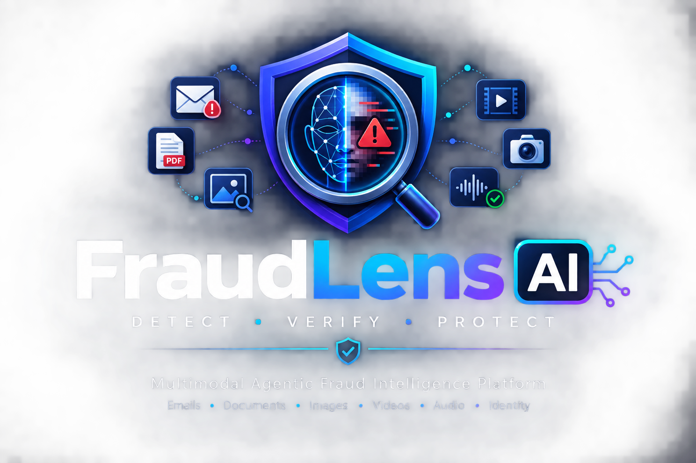
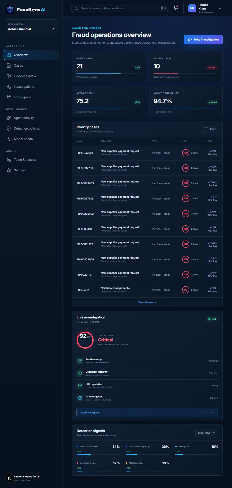
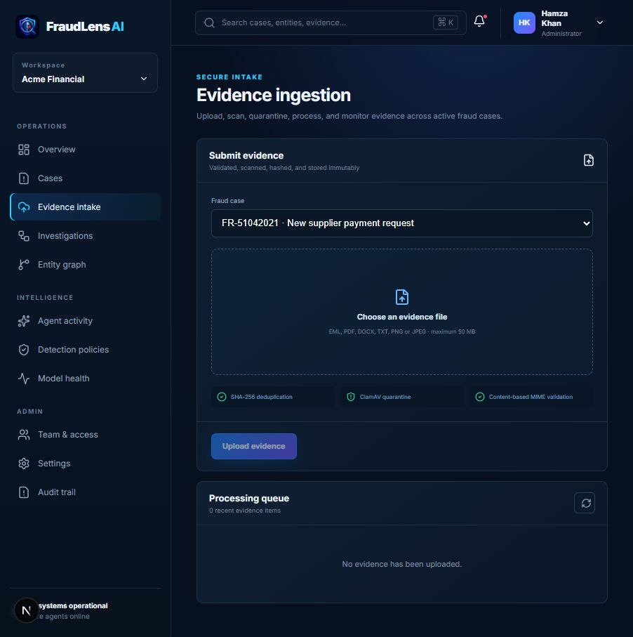
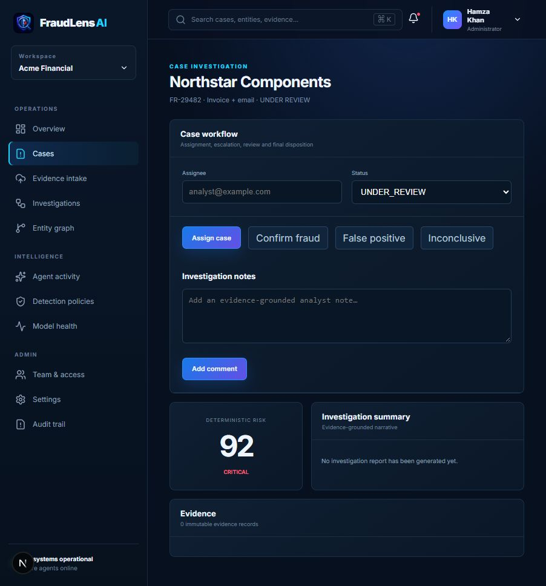
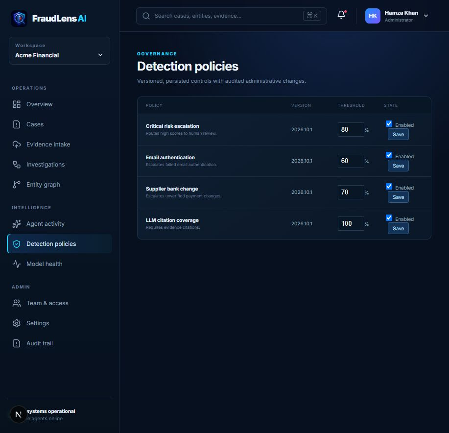
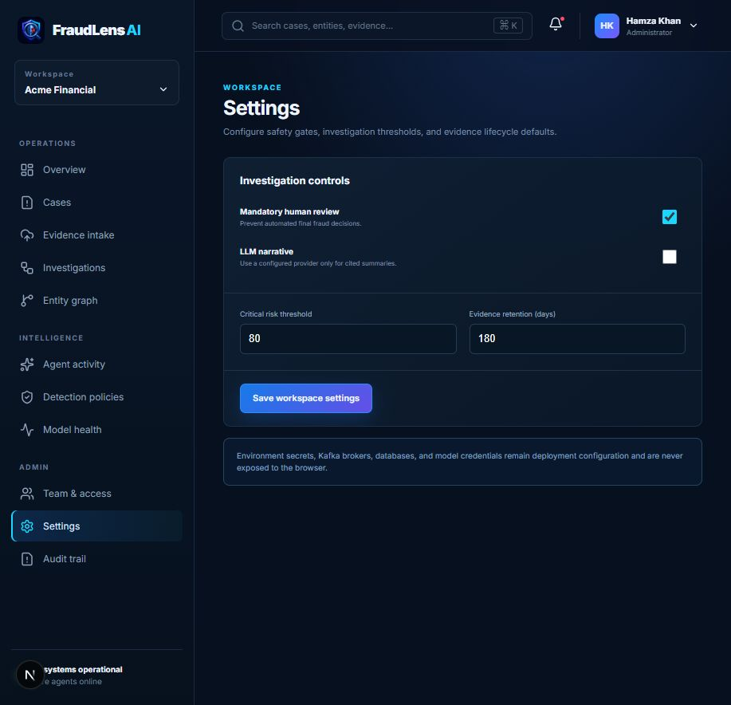

<p align="center">
  
</p>

<h1 align="center">Multimodal Agentic Fraud Intelligence Platform</h1>

<p align="center">
  <strong>Auditable deterministic detection + evidence-grounded LLM investigation.</strong>
</p>

## Working MVP foundation

### Product screenshots

| Dashboard | Evidence intake |
| --- | --- |
|  |  |

| Case workflow | Detection policies |
| --- | --- |
|  |  |



The repository now contains an executable enterprise foundation:

- `apps/api` — FastAPI control plane with deterministic email, document, and URL agents
- `apps/web` — responsive Next.js fraud-operations console
- deterministic, versioned risk scoring that cannot be overridden by an LLM
- optional OpenAI narrative generation restricted to cited findings
- Kafka-compatible investigation-completion events with an in-memory local fallback
- PostgreSQL, Redis, Kafka, and MinIO development infrastructure
- persistent tenant-scoped cases, evidence, investigation reports, and audit events
- API-key service authentication through a Next.js backend-for-frontend boundary
- Alembic migrations, agent step budgets, evidence citations, human-review defaults, tests, and CI
- secure 50 MB evidence intake for EML, PDF, DOCX, TXT, PNG, and JPEG
- content-signature validation, SHA-256 deduplication, ClamAV quarantine, and MinIO object storage
- Kafka-backed asynchronous parsing with three-attempt retry/dead-letter handling
- automated 30-day original-object and 180-day upload-metadata retention enforcement

### Run locally

```bash
# API
python -m venv .venv
pip install -e "apps/api[dev]"
python -m fraudlens.db_upgrade
uvicorn fraudlens.main:app --app-dir apps/api/src --reload

# Web console (another terminal)
npm install
npm run dev
```

Open `http://localhost:3000` for the analyst console and `http://localhost:8000/docs` for the API.
Infrastructure can be started with `docker compose up -d`. This launches PostgreSQL, Redis, Kafka,
MinIO, ClamAV, the FastAPI control plane, evidence and retention workers, and the web console.

The local development API key is `fraudlens-local-dev-key`. Replace it through `API_KEY` in every
shared or deployed environment. The browser never receives this secret; Next.js route handlers
forward authenticated requests to FastAPI using `FRAUDLENS_API_KEY`.

### Implemented API workflow

```text
POST /api/v1/cases
POST /api/v1/cases/{case_id}/evidence
POST /api/v1/cases/{case_id}/investigate
POST /api/v1/cases/{case_id}/uploads
POST /api/v1/uploads/{upload_id}/retry
GET  /api/v1/cases/{case_id}
GET  /api/v1/uploads
GET  /api/v1/uploads/{upload_id}
GET  /api/v1/dashboard
GET  /api/v1/audit
GET  /api/v1/investigations
GET  /api/v1/graph
GET  /api/v1/agents
GET  /api/v1/policies
GET  /api/v1/models/health
```

The analyst console includes routed views for overview, secure evidence intake, cases and case details, investigations,
entity relationships, agent registry, detection policies, model readiness, team access, workspace
settings, and the audit trail. Case search and severity filters run interactively in the browser.

All workflow endpoints require `X-API-Key`; data access is scoped by `X-Tenant-ID` and mutations
record the actor supplied in `X-Actor`. Replace this service-key boundary with OIDC/JWT claims when
connecting an enterprise identity provider.

See [`docs/ARCHITECTURE.md`](docs/ARCHITECTURE.md) for product and system boundaries.

A production-oriented AI platform for detecting, investigating, scoring, and explaining fraud across **emails, documents, images, videos, audio, identities, URLs, and transaction-related evidence**.

The platform combines:

* Computer Vision
* NLP
* Large Language Models
* Multimodal AI
* Deepfake Detection
* Anti-Spoofing / Liveness Detection
* Document Intelligence
* Email Security
* Graph Analytics
* Fraud Risk Scoring
* Retrieval-Augmented Generation
* Agentic AI
* MLOps
* Observability
* Human-in-the-Loop Investigation

The goal is not simply to classify an uploaded file as fraudulent or legitimate.

The system behaves more like an **AI Fraud Investigator**.

It extracts evidence from multiple modalities, runs specialized detection models, correlates entities and signals, calculates a fraud-risk score, investigates inconsistencies, and generates an explainable fraud report.

---

# 1. Project Vision

Fraud rarely exists in only one source.

A fraudulent transaction may involve:

* A phishing email
* A fake invoice
* A manipulated PDF
* A spoofed sender domain
* A changed bank account
* A fake identity document
* A deepfake video
* A cloned voice
* A malicious QR code
* A suspicious URL
* A reused device
* Multiple accounts connected to the same fraud network

Traditional fraud systems often analyze these inputs separately.

This platform analyzes them together.

Example:

```text
Suspicious Email
      │
      ├── Sender analysis
      ├── Domain analysis
      ├── Language analysis
      ├── URL analysis
      │
      ▼
Invoice Attachment
      │
      ├── OCR
      ├── IBAN extraction
      ├── Company extraction
      ├── Metadata analysis
      ├── Visual manipulation detection
      │
      ▼
Historical Comparison
      │
      ├── Previous invoices
      ├── Previous bank accounts
      ├── Previous email behavior
      │
      ▼
Knowledge Graph
      │
      ├── Email
      ├── Bank Account
      ├── Device
      ├── Company
      ├── Phone
      └── Identity
      │
      ▼
Fraud Fusion Engine
      │
      ▼
AI Fraud Investigator
      │
      ▼
Explainable Fraud Report
```

---

# 2. Primary Use Cases

The platform is designed for several fraud-prevention scenarios.

## 2.1 Business Email Compromise

Detect emails attempting to impersonate:

* CEOs
* CFOs
* Suppliers
* Banks
* Internal employees
* Customers
* Business partners

Example:

```text
Please transfer €48,000 today.

Our banking details have changed.

Do not call because I am currently in a meeting.
```

The platform analyzes:

* Sender
* Reply-To
* SPF
* DKIM
* DMARC
* Domain similarity
* Suspicious URLs
* Social-engineering language
* Historical writing behavior
* Attachment content
* Bank-account changes

---

# 3. Phishing Detection

Detect:

* Credential phishing
* Fake password-reset emails
* Fake Microsoft / Google login pages
* Fake delivery messages
* Fake invoices
* Fake banking messages
* Malicious attachments
* Suspicious shortened URLs
* Lookalike domains

Example:

```text
microsoft.com

vs.

micros0ft-login.com
```

---

# 4. Invoice Fraud Detection

Analyze invoices for:

* Changed IBAN
* Changed SWIFT/BIC
* Altered amounts
* Fake supplier information
* Duplicate invoices
* Suspicious invoice numbering
* Fake company details
* Modified QR codes
* Manipulated document regions
* Unusual PDF metadata

Example result:

```text
Invoice Risk: 93%

Detected:

- Supplier name matches previous invoices
- Bank account does NOT match previous invoices
- PDF modified after original creation
- Amount region shows manipulation artifacts
- QR code redirects to unrelated domain
```

---

# 5. Identity Document Fraud

Analyze:

* Passport
* National ID
* Residence Permit
* Driver's License
* Employee ID
* Student ID
* Insurance Card

Possible checks:

* OCR
* MRZ parsing
* MRZ checksum validation
* Face extraction
* Document-number extraction
* Date validation
* Expiry validation
* Layout consistency
* Font consistency
* Photo replacement
* Tampering detection
* Barcode validation
* QR validation
* Metadata inspection

---

# 6. Image Fraud Detection

Detect:

* Image manipulation
* Photoshop edits
* AI-generated images
* Copy-move fraud
* Splicing
* Face replacement
* Screenshot fraud
* Fake payment confirmations
* Altered invoices
* Fake receipts
* Edited banking screenshots

Possible output:

```text
IMAGE MANIPULATION RISK: 88%

Suspicious Regions:

- Amount
- Recipient
- Transaction ID

Evidence:

- Different compression characteristics
- Inconsistent text rendering
- Edge artifacts detected
```

---

# 7. Video Deepfake Detection

Analyze uploaded or recorded video for:

* Face swaps
* Deepfake faces
* Synthetic avatars
* Temporal inconsistencies
* Abnormal facial geometry
* Lip-sync anomalies
* Lighting inconsistencies
* Replay attacks
* Virtual-camera attacks
* Pre-recorded video attacks

---

# 8. Voice Deepfake Detection

Analyze audio for:

* Synthetic speech
* Voice cloning
* Replay attacks
* Voice conversion
* Spectral anomalies
* Abnormal speech characteristics

---

# 9. Anti-Spoofing and Liveness Detection

The platform can support identity verification through live-camera challenges.

Possible active challenges:

```text
Turn your head left.

Blink twice.

Smile.

Read the following number:

5931
```

The system checks whether the user is:

* A real live person
* A photograph
* A phone screen
* A recorded video
* A face mask
* A deepfake
* An AI avatar
* A virtual webcam

---

# 10. Cross-Modal Fraud Investigation

One of the main differentiators of the platform is correlation between different sources.

Example:

```text
Email
  +
PDF Invoice
  +
Company History
  +
Bank Details
  +
Knowledge Graph
  +
Image Analysis
```

may produce:

```text
OVERALL FRAUD RISK

94 / 100

Classification:

CRITICAL

Primary Findings:

1. Sender domain created recently.
2. Reply-To differs from sender.
3. New IBAN detected.
4. Invoice layout differs from supplier history.
5. Amount field appears visually modified.
6. QR code redirects to suspicious website.
7. Communication language differs significantly from previous messages.
```

---

# 11. AI Fraud Investigator

Instead of sending everything directly to an LLM, the system uses specialized detection tools.

Architecture:

```text
Evidence
   │
   ▼
Specialized Detection Models
   │
   ▼
Normalized Findings
   │
   ▼
Fraud Risk Engine
   │
   ▼
AI Investigation Agent
   │
   ▼
Explainable Report
```

The AI investigator may autonomously perform steps such as:

```text
1. Read suspicious email.

2. Analyze email headers.

3. Extract attachment.

4. OCR invoice.

5. Extract supplier.

6. Extract bank account.

7. Compare supplier history.

8. Analyze PDF metadata.

9. Analyze embedded images.

10. Decode QR code.

11. Analyze QR destination.

12. Query fraud knowledge graph.

13. Compare related historical cases.

14. Run fraud detectors.

15. Calculate overall risk.

16. Generate investigation report.
```

---

# 12. High-Level Architecture

```text
                        ┌─────────────────────┐
                        │      End User       │
                        └─────────┬───────────┘
                                  │
                                  ▼
                        ┌─────────────────────┐
                        │  React / Next.js UI │
                        └─────────┬───────────┘
                                  │
                                  ▼
                        ┌─────────────────────┐
                        │    API Gateway      │
                        │      FastAPI        │
                        └─────────┬───────────┘
                                  │
              ┌───────────────────┼─────────────────────┐
              │                   │                     │
              ▼                   ▼                     ▼
        File Upload         Email Ingestion       Live Camera
              │                   │                     │
              └───────────────────┼─────────────────────┘
                                  ▼
                        ┌─────────────────────┐
                        │ Ingestion Service   │
                        └─────────┬───────────┘
                                  │
                                  ▼
                           Message Queue
                             Kafka
                                  │
       ┌──────────────────────────┼───────────────────────────┐
       │                          │                           │
       ▼                          ▼                           ▼
 Text Intelligence        Image Intelligence         Video Intelligence
       │                          │                           │
       ▼                          ▼                           ▼
 NLP / OCR / LLM           CV / Tampering            Deepfake / Liveness
       │                          │                           │
       └──────────────────────────┼───────────────────────────┘
                                  ▼
                        Fraud Fusion Engine
                                  │
                    ┌─────────────┼─────────────┐
                    │             │             │
                    ▼             ▼             ▼
                 Rules            ML        Knowledge Graph
                                                 │
                                                 ▼
                                              Neo4j
                    │
                    └─────────────┬─────────────┘
                                  ▼
                         Fraud Risk Score
                                  │
                                  ▼
                       AI Fraud Investigator
                                  │
                                  ▼
                        Evidence Validation
                                  │
                                  ▼
                       Explainable AI Report
```

---

# 13. Technology Stack

## Frontend

### Next.js

Primary frontend framework.

```text
Next.js
React
TypeScript
```

Responsibilities:

* Dashboard
* Fraud case management
* Upload UI
* Video recording
* Live identity verification
* Fraud reports
* Analyst workflow
* Admin pages

---

## UI Components

```text
Tailwind CSS
shadcn/ui
Lucide Icons
Recharts
```

Possible visualization:

* Fraud score
* Risk history
* Entity relationships
* Case timelines
* Detection heatmaps
* Model confidence
* Investigation steps

---

# 14. Backend

## FastAPI

Primary backend/API framework.

```text
Python
FastAPI
Pydantic
Uvicorn
```

Example services:

```text
/auth
/upload
/cases
/email-analysis
/document-analysis
/image-analysis
/video-analysis
/audio-analysis
/liveness
/fraud-score
/investigation
/reports
```

---

# 15. API Architecture

The platform should gradually evolve toward service-oriented architecture.

```text
api-gateway
│
├── auth-service
├── upload-service
├── email-service
├── document-service
├── image-service
├── video-service
├── audio-service
├── fraud-engine
├── graph-service
├── agent-service
└── reporting-service
```

For the MVP, these may remain modules inside one FastAPI application.

Later they can be extracted into microservices.

---

# 16. AI / Machine Learning Stack

Primary ML framework:

```text
PyTorch
```

Additional libraries:

```text
Transformers
Hugging Face
scikit-learn
NumPy
Pandas
SciPy
```

Use ONNX where low-latency inference is required.

```text
ONNX
ONNX Runtime
```

---

# 17. LLM Layer

The AI investigation engine should support multiple LLM providers.

Possible providers:

```text
OpenAI
Anthropic
Gemini
Mistral
Groq
Ollama
llama.cpp
```

The internal platform should use a provider abstraction.

Example:

```python
LLMProvider

├── OpenAIProvider
├── AnthropicProvider
├── GeminiProvider
├── GroqProvider
└── OllamaProvider
```

This prevents vendor lock-in.

---

# 18. Agentic AI Framework

For the core investigation engine, we can initially build a lightweight custom agent loop.

```text
PLAN
  │
  ▼
ACT
  │
  ▼
OBSERVE
  │
  ▼
VALIDATE
  │
  ▼
ADAPT
  │
  ▼
REPORT
```

Later integrations may include:

```text
LangGraph
LangChain
LlamaIndex
```

However, critical fraud decisions should remain deterministic and auditable.

The LLM should not directly determine whether a transaction is fraudulent.

---

# 19. NLP Stack

Email and document analysis:

```text
Transformers
spaCy
Hugging Face
sentence-transformers
scikit-learn
```

NLP tasks:

* Named Entity Recognition
* Fraud classification
* Intent classification
* Social-engineering detection
* Semantic similarity
* Writing-style comparison
* Entity extraction
* Relationship extraction

Entities:

```text
PERSON
COMPANY
EMAIL
PHONE
ADDRESS
IBAN
BIC
URL
DOMAIN
INVOICE_NUMBER
VAT_NUMBER
AMOUNT
CURRENCY
DATE
```

---

# 20. OCR Stack

Initial OCR:

```text
PaddleOCR
```

Fallback / alternative:

```text
Tesseract OCR
EasyOCR
```

Potential cloud integrations:

```text
AWS Textract
Azure Document Intelligence
Google Document AI
```

The initial product should remain capable of running locally where required.

---

# 21. Document Intelligence

Libraries:

```text
PyMuPDF
pdfplumber
pypdf
python-docx
Pillow
OpenCV
```

For layout-aware document AI:

```text
LayoutLM
LayoutLMv3
Donut
DocTR
```

Tasks:

```text
Document Classification

Layout Detection

Table Extraction

OCR

Entity Extraction

Document Tampering Detection

Metadata Analysis
```

---

# 22. Computer Vision

Primary libraries:

```text
PyTorch
OpenCV
TorchVision
Pillow
```

Possible models:

```text
YOLO
Vision Transformers
ConvNeXt
EfficientNet
ResNet
CLIP
```

Tasks:

* Object detection
* Face detection
* Document-region detection
* Image classification
* Tampering detection
* Image similarity
* Document comparison

---

# 23. Face Detection

Possible stack:

```text
RetinaFace
MediaPipe
InsightFace
OpenCV
```

Responsibilities:

```text
Face Detection

Face Alignment

Face Embedding

Identity Similarity

Face Quality

Liveness Features
```

---

# 24. Face Recognition / Face Matching

Use:

```text
InsightFace
ArcFace
```

Example:

```text
Passport Photo
      │
      ▼
Face Embedding

Live Selfie
      │
      ▼
Face Embedding

      │
      ▼
Cosine Similarity
      │
      ▼
Identity Match Score
```

---

# 25. Deepfake Detection

Potential approaches:

```text
CNN-based detection
Vision Transformers
Temporal models
Frequency-domain analysis
Face consistency
Lip-sync analysis
```

Possible model families:

```text
Xception
EfficientNet
ViT
Swin Transformer
TimeSformer
```

Training/evaluation datasets can include public deepfake benchmarks.

The system should use multiple signals instead of relying on one detector.

---

# 26. Image Manipulation Detection

Techniques:

```text
Error Level Analysis

Compression Analysis

Noise Analysis

Copy-Move Detection

Image Splicing Detection

Frequency Analysis

Metadata Analysis

CNN Classification
```

Libraries:

```text
OpenCV
PyTorch
scikit-image
Pillow
ExifTool
```

---

# 27. Audio Processing

Primary tools:

```text
PyTorch
torchaudio
librosa
FFmpeg
```

Speech-to-text:

```text
Whisper
faster-whisper
```

Audio fraud tasks:

```text
Speech transcription

Speaker verification

Synthetic speech detection

Replay attack detection

Audio anomaly detection
```

---

# 28. Audio Deepfake Detection

Potential features:

```text
Mel Spectrograms

MFCC

Spectral Features

Voice Embeddings

Temporal Features
```

Potential architectures:

```text
CNN
Transformer
Wav2Vec2
HuBERT
Audio Spectrogram Transformer
```

---

# 29. Video Processing

Core stack:

```text
FFmpeg
OpenCV
PyAV
PyTorch
```

Processing:

```text
Video Upload
    │
    ▼
Metadata Extraction
    │
    ▼
Frame Sampling
    │
    ▼
Face Detection
    │
    ▼
Deepfake Analysis
    │
    ▼
Audio Extraction
    │
    ▼
Voice Analysis
    │
    ▼
Audio/Video Synchronization
```

---

# 30. Liveness Detection

Two modes:

## Passive Liveness

No interaction required.

Analyze:

```text
Skin texture

Screen reflections

Depth cues

Moiré patterns

Display artifacts

Lighting

Facial movement
```

## Active Liveness

Require randomized actions.

```text
Blink

Smile

Turn Left

Turn Right

Look Up

Read Number

Move Closer
```

Randomized challenges prevent replay attacks.

---

# 31. Email Intelligence

Use:

```text
Python email package
mail-parser
dnspython
BeautifulSoup
```

Analyze:

```text
From

Reply-To

Return-Path

Received headers

Message-ID

SPF

DKIM

DMARC

Links

Attachments

HTML

Tracking domains
```

---

# 32. Domain Security

Analyze:

```text
Domain similarity

Typosquatting

Homoglyph attacks

Subdomain manipulation

Redirect chains

Domain age

Certificate information

DNS records
```

Example:

```text
paypal.com

paypaI.com

The second domain uses uppercase I instead of lowercase L.
```

---

# 33. URL Intelligence

Extract URLs from:

```text
Emails

Documents

QR codes

Images
```

Analyze:

```text
Domain reputation

Redirect chain

Suspicious parameters

IP-hosted URLs

URL shortening

Typosquatting

Homoglyphs
```

Integrations may eventually include external threat-intelligence APIs.

---

# 34. QR Code Analysis

Use:

```text
OpenCV QRCodeDetector

pyzbar
```

Pipeline:

```text
Image
   │
   ▼
QR Detection
   │
   ▼
Decode
   │
   ▼
Extract URL / Payment Data
   │
   ▼
Fraud Analysis
```

---

# 35. Fraud Risk Engine

A critical component.

The platform should not rely entirely on LLM decisions.

Risk scoring combines:

```text
Rule Engine

Machine Learning

Computer Vision

NLP

Graph Risk

Historical Behavior

External Intelligence
```

Example:

```text
Email phishing           0.91

Document manipulation    0.84

IBAN anomaly             0.95

Domain anomaly           0.88

Graph connection         0.71
```

Fusion engine:

```text
Weighted Scoring
        +
ML Meta-Classifier
        +
Business Rules
```

Output:

```text
Fraud Score = 92 / 100

Severity = CRITICAL
```

---

# 36. Fraud Rules Engine

Initial implementation:

```text
Python Rules Engine
```

Later:

```text
Drools

Open Policy Agent
```

Example:

```text
IF

supplier_exists = true

AND

bank_account_changed = true

AND

email_domain_changed = true

THEN

risk += 40
```

---

# 37. Machine Learning Fraud Scoring

Possible models:

```text
Logistic Regression

Random Forest

XGBoost

LightGBM

Neural Networks
```

Initial recommendation:

```text
LightGBM / XGBoost
```

because fraud signals are often structured/tabular.

---

# 38. Anomaly Detection

Use:

```text
Isolation Forest

One-Class SVM

Autoencoders

Local Outlier Factor
```

Examples:

```text
New payment amount

Unusual login device

Unusual invoice pattern

New supplier bank account

Unusual communication behavior
```

---

# 39. Knowledge Graph

Graph database:

```text
Neo4j
```

Entities:

```text
User

Company

Bank Account

Email Address

Phone

Device

IP Address

Domain

Invoice

Transaction

Identity

Document
```

Relationships:

```text
OWNS

USES

SENT

PAID

CONNECTED_TO

BELONGS_TO

UPLOADED

REFERENCES
```

Example:

```text
Person A
   │
   └── uses → Device X

Person B
   │
   └── uses → Device X

Person C
   │
   └── owns → Bank Account Z

Person B
   │
   └── paid → Bank Account Z
```

This may indicate coordinated fraud.

---

# 40. Vector Database

Primary:

```text
Qdrant
```

Store:

* Fraud cases
* Email embeddings
* Document embeddings
* Investigation reports
* Fraud patterns
* Historical evidence
* Threat intelligence

Embedding models:

```text
sentence-transformers
```

Potential models:

```text
BGE

E5

MiniLM
```

---

# 41. Retrieval-Augmented Generation

RAG allows the investigation agent to retrieve:

```text
Previous fraud cases

Policies

Known scam patterns

Previous supplier invoices

Security guidelines

Threat intelligence

Investigation notes
```

Pipeline:

```text
Query
  │
  ▼
Embedding
  │
  ▼
Qdrant
  │
  ▼
Top Matching Evidence
  │
  ▼
Reranker
  │
  ▼
LLM
```

---

# 42. Reranking

Possible:

```text
CrossEncoder

BGE Reranker
```

This improves evidence retrieval.

---

# 43. Relational Database

Primary:

```text
PostgreSQL
```

Store:

```text
Users

Organizations

Cases

Uploads

Model Results

Fraud Scores

Transactions

Extracted Entities

Investigations

Reports

Audit Logs

Human Reviews
```

---

# 44. Object Storage

Development:

```text
MinIO
```

Production options:

```text
AWS S3

Azure Blob Storage

Google Cloud Storage
```

Store:

```text
Images

Videos

Audio

PDFs

Attachments

Generated reports
```

---

# 45. Cache

Use:

```text
Redis
```

For:

```text
Sessions

Rate limiting

Caching

Temporary results

Agent state

Job progress

Distributed locks
```

---

# 46. Messaging / Event Streaming

Primary:

```text
Apache Kafka
```

Kafka handles long-running workloads.

Example:

```text
File Uploaded
      │
      ▼
Kafka Topic
      │
      ├── OCR Worker
      ├── Image Worker
      ├── Video Worker
      ├── Audio Worker
      ├── Fraud Worker
      └── Notification Worker
```

Kafka topics could include:

```text
fraud.upload.created

fraud.email.analysis

fraud.document.analysis

fraud.image.analysis

fraud.video.analysis

fraud.audio.analysis

fraud.case.completed
```

---

# 47. Background Workers

Use:

```text
Celery
```

with:

```text
Redis
```

for smaller asynchronous tasks.

Kafka should handle major distributed events.

Celery may handle:

```text
Generate PDF

Send notification

Run OCR

Create thumbnail

Generate embedding
```

---

# 48. Authentication

Initial:

```text
JWT

OAuth 2.0

OpenID Connect
```

Possible identity providers:

```text
Keycloak

Auth0

Azure Entra ID
```

Self-hosted recommendation:

```text
Keycloak
```

---

# 49. Authorization

Implement:

```text
RBAC
```

Roles:

```text
User

Fraud Analyst

Senior Analyst

Compliance Officer

Admin
```

Later:

```text
ABAC
```

may be introduced for enterprise policies.

---

# 50. Security

Security is essential because the system handles sensitive documents.

Required:

```text
TLS

Encryption at Rest

Encryption in Transit

JWT Validation

RBAC

Rate Limiting

Malware Scanning

Audit Logging

Secret Management

Input Validation

File-Type Validation
```

---

# 51. Malware Scanning

Uploaded files should never be trusted.

Use:

```text
ClamAV
```

Pipeline:

```text
Upload
   │
   ▼
Quarantine
   │
   ▼
Malware Scan
   │
   ├── malicious → reject
   │
   └── safe
        │
        ▼
   AI Processing
```

Never process an untrusted file directly inside the main application process.

---

# 52. File Isolation

Suspicious documents should run inside isolated workers.

Possible:

```text
Docker Sandboxing

Kubernetes Jobs

Restricted Containers
```

Workers should have:

```text
No unnecessary network access

Read-only filesystem

Limited CPU

Limited memory

Timeouts
```

---

# 53. Secrets Management

Development:

```text
.env
```

Production:

```text
HashiCorp Vault

Kubernetes Secrets

Cloud Secret Managers
```

Never commit:

```text
API Keys

Database Credentials

Encryption Keys
```

---

# 54. Encryption

Sensitive evidence should use encryption.

Possible:

```text
AES-256 at rest

TLS 1.3 in transit
```

Personally identifiable information should be protected separately where appropriate.

---

# 55. PII Detection

Detect:

```text
Name

Address

Phone

Email

Passport

ID Number

Bank Account

Credit Card

Date of Birth
```

PII can be masked in logs and reports depending on authorization.

---

# 56. Audit Logging

Every important action should produce an immutable audit event.

Example:

```json
{
  "user": "analyst_18",
  "action": "VIEW_CASE",
  "case_id": "FRAUD-2026-8394",
  "timestamp": "2026-08-10T16:42:00Z"
}
```

---

# 57. Human-in-the-Loop

AI should assist analysts, not silently make irreversible decisions.

Workflow:

```text
AI Analysis
     │
     ▼
Risk Score
     │
     ▼
Analyst Review
     │
 ┌───┴────┐
 ▼        ▼
Approve  Reject
 │        │
 └───┬────┘
     ▼
Feedback Dataset
```

Human decisions may be used for model improvement.

---

# 58. Explainable AI

Every fraud score should include evidence.

Bad:

```text
Fraud probability = 94%
```

Good:

```text
Fraud probability = 94%

Reasons:

+35 sender-domain anomaly

+25 bank-account change

+15 document manipulation

+10 suspicious QR code

+9 communication anomaly
```

---

# 59. Model Confidence

Each model should return standardized output.

Example:

```json
{
  "model": "invoice_tamper_detector",
  "version": "1.2.0",
  "prediction": "tampered",
  "confidence": 0.91
}
```

---

# 60. Standard Evidence Schema

All detectors should produce normalized findings.

```json
{
  "detector": "iban_anomaly_detector",
  "category": "document",
  "severity": "high",
  "confidence": 0.97,
  "finding": "Previously unseen supplier bank account",
  "evidence": {
    "previous_iban": "DE...",
    "current_iban": "LT..."
  }
}
```

This lets the fusion engine process evidence consistently.

---

# 61. Model Registry

Use:

```text
MLflow
```

Track:

```text
Model Versions

Training Runs

Metrics

Parameters

Artifacts

Model Promotion
```

Example:

```text
deepfake-detector

v1 → staging

v2 → production

v3 → experimental
```

---

# 62. Experiment Tracking

Use:

```text
MLflow
```

Optional:

```text
Weights & Biases
```

Track:

```text
Accuracy

Precision

Recall

F1

ROC-AUC

PR-AUC

False Positive Rate

False Negative Rate
```

Fraud detection should focus strongly on precision/recall rather than accuracy alone.

---

# 63. LLM Observability

Use:

```text
Langfuse
```

Track:

```text
Agent traces

Prompts

LLM responses

Token usage

Latency

Errors

Tool calls

Evaluation
```

---

# 64. RAG Evaluation

Use:

```text
RAGAS

DeepEval
```

Measure:

```text
Faithfulness

Answer relevance

Context relevance

Citation correctness
```

---

# 65. Application Monitoring

Use:

```text
Prometheus

Grafana
```

Monitor:

```text
Requests

Latency

Error rate

CPU

Memory

GPU usage

Kafka lag

Worker health

Model latency
```

---

# 66. Distributed Tracing

Use:

```text
OpenTelemetry
```

Potential backend:

```text
Jaeger
```

Trace:

```text
API Request
      │
      ▼
Upload Service
      │
      ▼
Kafka
      │
      ▼
OCR
      │
      ▼
Fraud Engine
      │
      ▼
Agent
```

---

# 67. Logging

Use:

```text
structlog
```

Centralized logging:

```text
Loki
```

or:

```text
ELK Stack
```

Recommended:

```text
Grafana Loki
```

for the initial platform.

---

# 68. Deployment

Development:

```text
Docker

Docker Compose
```

Production:

```text
Docker

Kubernetes
```

---

# 69. Kubernetes Components

```text
Frontend Deployment

API Deployment

Worker Deployment

Model Deployment

Redis

Kafka

PostgreSQL

Qdrant

Neo4j

Ingress

Services

ConfigMaps

Secrets

Horizontal Pod Autoscaler
```

---

# 70. GPU Workers

Video and deepfake detection may require GPU inference.

Example:

```text
CPU Node Pool

API
OCR
Email analysis
Rules

GPU Node Pool

Deepfake detection
Vision models
Audio models
Large LLM
```

---

# 71. Model Serving

Initial:

```text
FastAPI model services
```

Later:

```text
NVIDIA Triton Inference Server
```

Triton can serve:

```text
PyTorch

ONNX

TensorRT
```

models efficiently.

---

# 72. CI/CD

Use:

```text
GitHub Actions
```

Pipeline:

```text
Developer Push
      │
      ▼
GitHub
      │
      ▼
GitHub Actions
      │
      ├── Lint
      ├── Unit Tests
      ├── Security Scan
      ├── Build Docker Image
      ├── Push Image
      └── Deploy
```

---

# 73. Code Quality

Python:

```text
Ruff

Black

mypy

pytest
```

Frontend:

```text
ESLint

Prettier

TypeScript
```

---

# 74. Security Scanning

Use:

```text
Bandit

Trivy

Dependabot

GitHub CodeQL
```

Scan:

```text
Source code

Dependencies

Docker images

Secrets

Vulnerabilities
```

---

# 75. Infrastructure as Code

Use:

```text
Terraform
```

Manage:

```text
Networks

Kubernetes

Databases

Storage

DNS

Monitoring
```

---

# 76. GitOps

Future:

```text
Argo CD
```

Architecture:

```text
GitHub
   │
   ▼
Docker Registry
   │
   ▼
GitOps Repository
   │
   ▼
Argo CD
   │
   ▼
Kubernetes
```

---

# 77. Suggested Repository Structure

```text
multimodal-fraud-intelligence/
│
├── apps/
│   │
│   ├── frontend/
│   │
│   └── api/
│
├── services/
│   │
│   ├── email_intelligence/
│   ├── document_intelligence/
│   ├── image_intelligence/
│   ├── video_intelligence/
│   ├── audio_intelligence/
│   ├── identity_verification/
│   ├── fraud_engine/
│   ├── graph_intelligence/
│   ├── agent_investigator/
│   └── reporting/
│
├── ml/
│   │
│   ├── email_models/
│   ├── document_models/
│   ├── image_models/
│   ├── deepfake_models/
│   ├── liveness_models/
│   ├── audio_models/
│   ├── anomaly_detection/
│   └── fraud_scoring/
│
├── shared/
│   │
│   ├── schemas/
│   ├── security/
│   ├── logging/
│   ├── config/
│   └── utils/
│
├── infrastructure/
│   │
│   ├── docker/
│   ├── kubernetes/
│   ├── terraform/
│   ├── monitoring/
│   └── kafka/
│
├── evaluation/
│   │
│   ├── datasets/
│   ├── model_evaluation/
│   ├── rag_evaluation/
│   └── agent_evaluation/
│
├── tests/
│   │
│   ├── unit/
│   ├── integration/
│   ├── security/
│   └── e2e/
│
├── docs/
│   │
│   ├── ARCHITECTURE.md
│   ├── SECURITY.md
│   ├── FRAUD_ENGINE.md
│   ├── AI_MODELS.md
│   ├── KNOWLEDGE_GRAPH.md
│   └── DEPLOYMENT.md
│
├── docker-compose.yml
├── Makefile
├── pyproject.toml
└── README.md
```

---

# 78. Core Database Schema

Possible PostgreSQL entities:

```text
users

organizations

cases

uploads

documents

emails

images

videos

audio_files

identities

transactions

entities

model_results

fraud_findings

fraud_scores

investigations

agent_steps

analyst_decisions

audit_logs
```

---

# 79. Fraud Case

Example:

```json
{
  "case_id": "CASE-29482",
  "organization_id": "ORG-18",
  "status": "UNDER_REVIEW",
  "risk_score": 92,
  "severity": "CRITICAL",
  "created_at": "2026-08-10T14:20:32Z"
}
```

---

# 80. Investigation Report

Example output:

```text
CASE

FRAUD-2026-29482


OVERALL FRAUD RISK

92 / 100

CRITICAL


EMAIL

91%

- Sender domain anomaly
- Reply-To mismatch
- Urgency language detected


DOCUMENT

86%

- New bank account
- PDF metadata inconsistency
- Modified invoice region


URL

79%

- Recently observed domain
- Redirect chain detected


IMAGE

72%

- Compression inconsistencies
- Suspicious amount region


KNOWLEDGE GRAPH

68%

- Bank account connected to another flagged case


AI INVESTIGATION SUMMARY

The email strongly resembles a Business Email Compromise attack.

The supplier identity appears legitimate, but the sender domain and banking
information differ from historical communication.

The attached invoice also contains visual inconsistencies around the payment
details.

RECOMMENDATION

Do not authorize payment.

Verify the supplier through previously trusted contact details.
```

---

# 81. Platform Dashboard

Dashboard could provide:

```text
Total Cases

Critical Cases

High Risk Cases

Fraud Detected

Average Risk

Pending Reviews

False Positives

Confirmed Fraud
```

Charts:

```text
Fraud by Type

Fraud by Day

Risk Distribution

Detection Model Performance

Fraud Sources

Top Suspicious Domains
```

---

# 82. Case Investigation UI

A case page may contain:

```text
Case Overview

Evidence

Email

Documents

Images

Videos

Extracted Entities

Risk Factors

Knowledge Graph

AI Investigation

Timeline

Analyst Notes

Decision
```

---

# 83. Knowledge Graph UI

Visualization:

```text
                    Company
                       │
                       │
Email ───── Person ────┼──── Bank Account
  │                    │
Domain                Device
                       │
                       │
                      IP
```

Users should be able to interactively explore suspicious relationships.

---

# 84. Fraud Heatmaps

For manipulated images and documents:

```text
Original Image

+

AI Heatmap

+

Bounding Boxes
```

Example:

```text
Potentially manipulated areas:

[x] Amount

[x] Account number

[x] Transaction ID
```

---

# 85. AI Investigator Tools

The agent may receive tools such as:

```text
analyze_email()

extract_document_text()

extract_entities()

analyze_document_metadata()

detect_image_manipulation()

detect_deepfake()

analyze_audio()

verify_identity()

query_graph()

search_previous_cases()

analyze_url()

decode_qr()

compare_bank_accounts()

calculate_risk()
```

---

# 86. Agent Safety

The agent must have:

```text
Maximum steps

Timeouts

Tool permissions

Structured output

Evidence requirements

Citation requirements

Retry limits

Human approval gates
```

The agent should never fabricate investigation evidence.

---

# 87. Evidence Validation

Every important AI claim should reference evidence.

Example:

```json
{
  "claim": "Bank account changed",
  "evidence": [
    "invoice_2026_09.pdf#iban",
    "supplier_profile#verified_iban"
  ]
}
```

---

# 88. Model Evaluation

Each detector should have its own benchmark.

Email:

```text
Precision
Recall
F1
PR-AUC
```

Deepfake:

```text
ROC-AUC
EER
F1
Cross-dataset accuracy
```

Liveness:

```text
APCER
BPCER
ACER
```

Fraud engine:

```text
Precision
Recall
F1
PR-AUC
False Positive Rate
Fraud Detection Rate
```

---

# 89. Model Drift

Future monitoring:

```text
Evidently AI
```

Monitor:

```text
Input drift

Prediction drift

Feature drift

Model performance
```

---

# 90. Privacy

The platform should follow privacy-by-design principles.

Potential requirements:

```text
GDPR

Data minimization

Retention policies

Right to deletion

Encrypted storage

Purpose limitation

Access control
```

---

# 91. Data Retention

Organizations should be able to configure policies.

Example:

```text
Original uploads: 30 days

Extracted features: 180 days

Fraud case metadata: 7 years

Audit logs: configurable
```

Exact retention must depend on legal and organizational requirements.

---

# 92. Deployment Modes

The platform should ultimately support:

```text
Cloud SaaS

Private Cloud

On-Premise

Air-Gapped Enterprise
```

This is especially important for:

```text
Banks

Government

Insurance

Healthcare

Legal organizations
```

---

# 93. Local AI Support

For privacy-sensitive deployments:

```text
Ollama

llama.cpp

Local embedding models

Local OCR

Local computer vision

Local vector database
```

No sensitive documents need to leave the customer's infrastructure.

---

# 94. Development Environment

Recommended:

```text
Python 3.12+

Node.js

Docker

Docker Compose

PostgreSQL

Redis

Qdrant

Neo4j
```

---

# 95. Local Development Architecture

```text
docker-compose
│
├── PostgreSQL
├── Redis
├── Qdrant
├── Neo4j
├── Kafka
├── MinIO
└── Backend

Local machine
│
├── Next.js
└── ML workers
```

---

# 96. Example Docker Compose Services

```yaml
services:

  postgres:

  redis:

  kafka:

  qdrant:

  neo4j:

  minio:

  api:

  fraud-worker:

  image-worker:

  video-worker:
```

---

# 97. Development Phases

## Phase 1 — Core Platform

Build:

```text
FastAPI

Next.js

PostgreSQL

Docker

Upload API

Case Management

Authentication
```

---

## Phase 2 — Email Fraud Detection

Implement:

```text
Email Parser

Header Analysis

URL Extraction

Domain Checks

Phishing NLP Classifier

LLM Explanation
```

---

## Phase 3 — Document Intelligence

Implement:

```text
PDF parsing

OCR

Invoice classification

Entity extraction

IBAN extraction

Metadata analysis
```

---

## Phase 4 — Image Fraud

Implement:

```text
Image metadata

Tampering detection

AI-generated image detection

Suspicious-region visualization
```

---

## Phase 5 — Video Fraud

Implement:

```text
Frame extraction

Face detection

Deepfake detection

Audio extraction

Lip-sync analysis
```

---

## Phase 6 — Anti-Spoofing

Implement:

```text
Face matching

Passive liveness

Active liveness

Replay detection
```

---

## Phase 7 — Fraud Fusion Engine

Combine:

```text
Email risk

Document risk

Image risk

Video risk

Audio risk

Graph risk

Historical risk
```

---

## Phase 8 — AI Fraud Investigator

Implement agent:

```text
Plan

Investigate

Use Tools

Validate Evidence

Calculate Risk

Generate Report
```

---

## Phase 9 — Knowledge Graph

Add:

```text
Neo4j

Entity extraction

Relationship mapping

Fraud-ring detection
```

---

## Phase 10 — MLOps

Add:

```text
MLflow

Langfuse

Prometheus

Grafana

OpenTelemetry
```

---

## Phase 11 — Production Deployment

Add:

```text
Kubernetes

Terraform

Argo CD

GPU inference

Horizontal scaling
```

---

# 98. Initial MVP Technology Stack

To prevent overengineering, the first usable version should use:

```text
Frontend

Next.js
React
TypeScript
Tailwind
shadcn/ui


Backend

Python
FastAPI
Pydantic


ML

PyTorch
Transformers
scikit-learn
OpenCV


OCR

PaddleOCR


Video

OpenCV
FFmpeg


Audio

faster-whisper
librosa


Database

PostgreSQL


Vector DB

Qdrant


Graph DB

Neo4j


Cache

Redis


Object Storage

MinIO


Messaging

Kafka


LLM

Provider abstraction
OpenAI / Groq / Ollama


Agent

Custom Python agent loop


Deployment

Docker
Docker Compose


Testing

pytest


CI/CD

GitHub Actions
```

---

# 99. Full Production Technology Stack

```text
Frontend
──────────────────────────────
Next.js
React
TypeScript
Tailwind CSS
shadcn/ui
Recharts


Backend
──────────────────────────────
Python
FastAPI
Pydantic
Uvicorn


Machine Learning
──────────────────────────────
PyTorch
Transformers
scikit-learn
ONNX Runtime


Computer Vision
──────────────────────────────
OpenCV
TorchVision
InsightFace
MediaPipe


Document AI
──────────────────────────────
PaddleOCR
PyMuPDF
LayoutLM
Donut


Video
──────────────────────────────
FFmpeg
OpenCV
PyAV


Audio
──────────────────────────────
faster-whisper
torchaudio
librosa


LLM
──────────────────────────────
OpenAI
Anthropic
Gemini
Mistral
Groq
Ollama
llama.cpp


RAG
──────────────────────────────
Qdrant
sentence-transformers
CrossEncoder


Graph
──────────────────────────────
Neo4j


Relational Database
──────────────────────────────
PostgreSQL


Cache
──────────────────────────────
Redis


Object Storage
──────────────────────────────
MinIO / S3


Streaming
──────────────────────────────
Apache Kafka


Background Jobs
──────────────────────────────
Celery


Authentication
──────────────────────────────
Keycloak
OAuth 2.0
OpenID Connect
JWT


Security
──────────────────────────────
ClamAV
Trivy
Bandit
CodeQL


Agentic AI
──────────────────────────────
Custom Agent Runtime
LangGraph later


MLOps
──────────────────────────────
MLflow


LLM Observability
──────────────────────────────
Langfuse


Evaluation
──────────────────────────────
RAGAS
DeepEval


Application Observability
──────────────────────────────
Prometheus
Grafana
OpenTelemetry
Loki


Containerization
──────────────────────────────
Docker


Orchestration
──────────────────────────────
Kubernetes


Infrastructure
──────────────────────────────
Terraform


GitOps
──────────────────────────────
Argo CD


CI/CD
──────────────────────────────
GitHub Actions
```

---

# 100. Important Architecture Principle

The LLM must not be treated as the fraud detector itself.

Incorrect architecture:

```text
File
  │
  ▼
LLM
  │
  ▼
Fraud / Not Fraud
```

Recommended architecture:

```text
                  File
                    │
                    ▼
         Specialized Detectors
                    │
        ┌───────────┼───────────┐
        ▼           ▼           ▼
      NLP          CV         Rules
        │           │           │
        └───────────┼───────────┘
                    ▼
              Evidence Layer
                    │
                    ▼
             Fraud Risk Engine
                    │
                    ▼
             AI Investigator
                    │
                    ▼
              Explanation
```

Specialized models generate evidence.

The fraud engine makes the structured risk calculation.

The LLM investigates and explains the result.

---

# 101. Long-Term Vision

The final product could become:

> **An AI-native multimodal fraud investigation platform capable of analyzing emails, documents, images, identities, audio, videos, URLs, transactions, and entity relationships to detect fraud, deepfakes, spoofing, phishing, document manipulation, identity fraud, and coordinated fraud networks.**

Potential customers include:

```text
Banks

FinTech

Insurance Companies

Payment Providers

Marketplaces

E-Commerce

Telecommunications

Government

Legal Organizations

Recruitment Platforms

Social Networks

Enterprise Security Teams
```

---

# 102. Product Positioning

Possible product description:

> A multimodal agentic fraud intelligence platform combining computer vision, NLP, deepfake detection, document intelligence, anti-spoofing, graph analytics, machine learning, and AI agents to detect, investigate, and explain complex digital fraud.

---

# 103. Project Status

```text
Status: Architecture / Initial Development

Current Target:

Build Multimodal Fraud Intelligence MVP
```

Initial priorities:

```text
[ ] Repository architecture

[ ] Docker development environment

[ ] PostgreSQL schema

[ ] FastAPI backend

[ ] Next.js dashboard

[ ] Upload pipeline

[ ] Email analyzer

[ ] Document analyzer

[ ] Image analyzer

[ ] Video analyzer

[ ] Fraud scoring engine

[ ] AI investigator

[ ] Explainable investigation report
```

---

# 104. Disclaimer

This project is intended as a fraud-detection and fraud-investigation assistance platform.

AI-generated scores should not automatically be treated as proof of fraud.

Critical decisions should use:

* Multiple independent signals
* Auditable evidence
* Defined business rules
* Human review
* Appropriate legal and compliance procedures

---

# License

License to be determined.

For an open-source core:

```text
Apache License 2.0
```

may be considered.

For a commercial platform, proprietary licensing can be used instead.

---

# Author

Developed as a multimodal AI, computer vision, cybersecurity, fraud intelligence, and agentic-AI platform.
